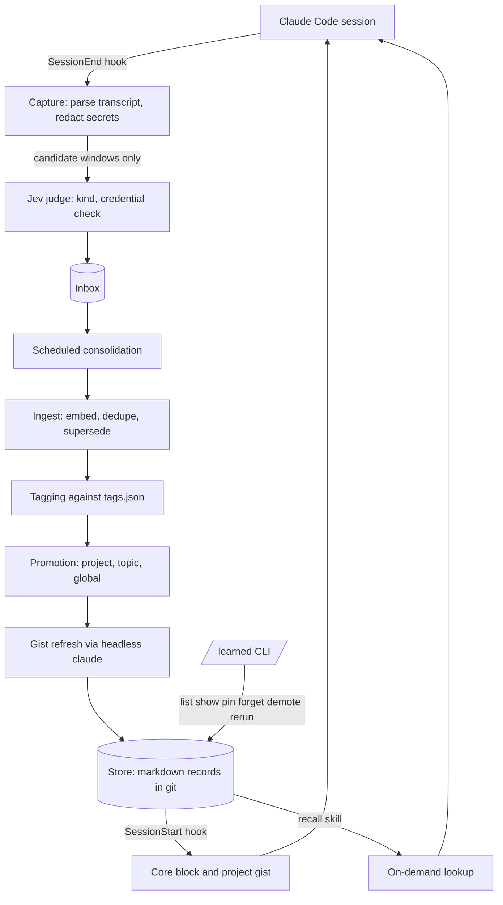

# learned: self-learning memory for Claude Code

`learned` watches your Claude Code sessions, keeps the decisions, rejections, preferences and
corrections you state, and feeds the relevant ones back into later sessions, so you stop
repeating yourself. Everything is stored locally as small markdown files in a git repo.

## Architecture



**Capture (SessionEnd hook).** A detached process parses the session transcript, keeps user turns
and the assistant message they answered, treats `AskUserQuestion` answers as high-value, and drops
tool output and pasted content. Secrets are stripped by regex. Only short redacted windows are
sent to the Jev judge (TypeSafe System One), which classifies each as `rejection`, `decision`,
`preference`, `correction` or `none`, and a separate check drops anything that looks like a
credential or private data. With no API key or network, windows are queued unclassified. A session
is never blocked.

**Consolidation (scheduled task).** New inbox records are embedded (sentence-transformers) and
compared with their nearest neighbours. Same fact: merge. Contradiction: the newer `stated` record
supersedes the older one. Records are tagged from a controlled vocabulary. Facts that recur across
two or more projects can be promoted to `topics/` or `global/` when three judgments (personal, same,
stable) clear the thresholds. Each project's `gist.md` is rewritten from its new records. A weekly
sweep decays stale records. Decay lowers rank and never deletes.

**Recall.** A SessionStart hook injects a capped block (about 1.5k tokens): the global core plus the
current project's gist and most recent decisions. The `recall` skill searches the store on demand.
Recalled facts are treated as background, not instructions.

**Controls.** `/learned list | show | pin | forget | demote | rerun [--full]`. `forget` leaves a
tombstone so a fact is not relearned, but it remains in the store's git history.

## Store layout

```
~/.claude/learned/        (a local git repo, no remote)
  inbox/                  candidate facts, one JSONL per session
  projects/<name>/        gist.md plus one markdown record per fact
  topics/  global/        promoted records
  tags.json               tag vocabulary with one-line descriptions
  core.md                 prebuilt always-loaded block
```

Each record is a markdown file with frontmatter (`kind`, `scope`, `project`, `tags`, `sources`,
`confidence: stated|inferred`, `status`, `created`, `last_seen`) and a one or two sentence body.

## Privacy

Raw transcripts never leave the machine. Candidate windows are redacted first and then sent to the
TypeSafe API for classification. A `.no-learn` file in a project opts it out.

## Install

Requires Windows, Python 3.13+ and a `TYPESAFE_API_KEY` environment variable.

```powershell
pip install -e .[dev]
pwsh scripts/install.ps1 -DryRun   # print the planned changes, modify nothing
pwsh scripts/install.ps1
```

The installer registers the hooks, the daily scheduled task, the `recall` skill and the `/learned`
command. `scripts/uninstall.ps1` reverses it. Open Claude Code sessions must be restarted to pick
up the hooks.

## Tests and evaluation

```
python -m pytest
python -m eval.run_eval --mode capture --labeled eval/labeled.jsonl --judge fake
```

`eval/labeled.jsonl` is synthetic example data. Replace it with real labels (30 to 50 facts)
before trusting any threshold suggestion from `--judge jev`. The first week runs in shadow mode:
promotions are logged but not applied.

## More

- [Design spec](2026-10-16-learned-memory-design.md)
- [Implementation plan](2026-10-16-learned-memory-plan.md)
